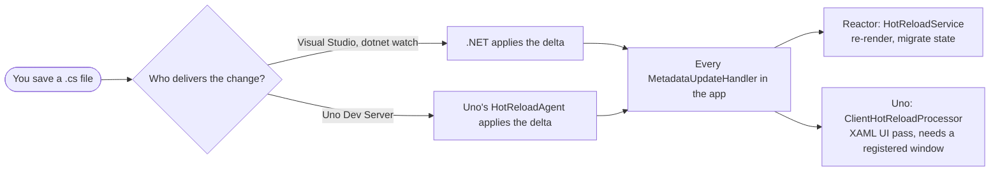

# Hot Reload in Reactor on Uno Platform

What Hot Reload a Reactor app gets on its own, what the Uno Platform adds, and what
doesn't work yet. For how to run it, see the port README's [Hot Reload](README.md#hot-reload)
section and the samples' [Hot Reload](../../samples/Uno/README.md#hot-reload) commands.

## In short

- **Reactor refreshes its own UI.** It registers a .NET `MetadataUpdateHandler`
  that re-renders the whole tree and carries hook state across the edit. It needs
  only one thing from outside: something that applies the code change to the running
  app and then calls the handlers.
- **On desktop, .NET can do that alone.** `dotnet watch` and Visual Studio apply the
  change and call the handlers, so Reactor's Hot Reload works without any Uno code.
- **Everywhere else, Uno's Dev Server does it.** WebAssembly, Android and iOS, VS Code
  and Rider without a debugger, and the command line with `uno-devserver` all rely on
  it. Reactor.Uno connects the app to the Dev Server itself, so the app needs no setup.
- **Some of Uno's tooling doesn't understand a Reactor app yet.** Edits apply, but Uno
  reports them as failed, and AI agents can't see the app through the Uno App MCP. See
  [Known issues](#known-issues).

## Two halves of Hot Reload

Hot Reload has two jobs, and Reactor and Uno each own one of them:

1. **Delivering the change.** Compile the edit into a delta, apply it to the running
   app, then call every `[assembly: MetadataUpdateHandler]` in the app. This job is
   done by Visual Studio, `dotnet watch`, or Uno's Dev Server, depending on how the app
   was started.
2. **Refreshing the UI.** The new code is in the runtime, but nothing on screen has
   changed yet. Reactor does this job itself. Uno's own handler does the same for XAML
   apps: it walks the visual tree and replaces the controls whose type was recreated.



The two handlers are peers, not layers: whoever delivers the change calls both.

## What Reactor does on its own

All of this is source-shared from the Windows framework, unchanged:

- [`HotReloadService`](../Reactor/Hosting/HotReloadService.cs) registers
  `[assembly: MetadataUpdateHandler(typeof(HotReloadService))]`. On each update it
  records the updated types and calls `RequestRender(force: true)` on the active host.
  `force` skips memoization, which would otherwise keep the old `Render()` output
  because props and dependencies haven't changed.
- **State survives.** Hook cells are matched by call order, so `UseState`,
  `UseReducer`, `UseRef` and `UseMemo` keep their values. When a record or class stored
  in a hook gains or loses a field,
  [`ReactorHotReloadCopier`](../Reactor/Hosting/ReactorHotReloadCopier.cs) copies the
  values field by field onto the new shape (spec 049).
- **Hook-shape edits recover.** Adding, removing or reordering hook calls raises a
  `HookOrderException`. During a Hot Reload pass Reactor treats it as "the shape
  changed": it runs the pending cleanups, drops that component's hook state and
  remounts, instead of showing the error fallback.
- **Release and NativeAOT builds pay nothing.** Under NativeAOT
  `MetadataUpdater.IsSupported` is `false`, so the migration code is trimmed away.

None of this depends on Uno. It works with any delivery mechanism that calls the
handlers, and fails with any that doesn't.

## What Uno adds

### The Dev Server delivers changes where .NET can't

Uno's Dev Server watches the project files, compiles each edit against the app's
build, and sends the delta to the app over a WebSocket. In the app, Uno's
`HotReloadAgent` applies it and then calls **every** `MetadataUpdateHandler` it finds
in the loaded assemblies, Reactor's included
([`HotReloadAgent`](https://github.com/unoplatform/uno/blob/master/src/Uno.UI.RemoteControl/HotReload/MetadataUpdater/HotReloadAgent.cs)).
Reactor therefore needs no Uno-specific handler.

This is what makes Reactor's Hot Reload reach:

- **WebAssembly.** `dotnet watch` has no path into an Uno WebAssembly app.
- **Android and iOS** started without a debugger. With Uno's Mono debugger in VS Code,
  the debugger applies the delta, and Uno's agent still calls the handlers with the
  updated types.
- **Desktop under VS Code or Rider** without a debugger, where no other tool applies
  changes.
- **The command line**: `uno-devserver start`, then start the app.
- **AI agents**: an agent's file edits reach the app through the Dev Server like any
  other edit. On Uno, Reactor's own devtools and MCP server are turned off
  (`DevtoolsEnabled` is `false`), so the Uno App MCP is the agent's way to see and drive
  the app. It doesn't recognize a Reactor app yet
  ([known issue](#the-app-mcp-doesnt-see-a-reactor-app)).

### How Reactor.Uno turns it on

The Dev Server connection needs these in the app, and Reactor.Uno or Uno.Sdk provide
them:

| What | Who provides it | Why it's needed |
|---|---|---|
| The Dev Server client (`Uno.WinUI.DevServer`) | Uno.Sdk, in Debug builds only | Ships the WebSocket client and Uno's Hot Reload agent. Release builds don't carry it, so they have no Hot Reload. |
| The Dev Server's address | The Uno build, from `UnoRemoteControlPort` in the project's `.csproj.user` | The IDE, or `uno-devserver start`, writes the port there. The build stamps it on the app assembly (`ServerEndpointAttribute`). |
| A call to `RemoteControlClient.Initialize(appType)` | Reactor.Uno, in [`DevServerConnection`](Hosting/DevServerConnection.cs) | A XAML app gets this call from its generated `App.xaml` code. A Reactor app has no `App.xaml`, so `ReactorApplication`'s constructor makes it, by reflection, with the root component's type, whose assembly carries the address. |
| `DOTNET_MODIFIABLE_ASSEMBLIES=debug` on WebAssembly, Android and iOS | The Dev Server package's build targets | Mono only accepts deltas with it. On the iOS simulator from the command line, the samples pass it with `SIMCTL_CHILD_` ([why](../../samples/Uno/README.md#android--ios)). |
| `DOTNET_MODIFIABLE_ASSEMBLIES=debug` on desktop | Whatever launches the app: the IDE, or `dotnet watch` | CoreCLR refuses every delta without it. See [Known issues](#desktop-apps-started-from-the-command-line-refuse-every-edit). |

`DevServerConnection` looks the client up by name rather than referencing it, so the
library doesn't depend on a Debug-only package. When the client is absent (Release),
when no app type is known, or when the app already called `Initialize`, it does
nothing. A failure is logged and never stops the app.

## By launch method

"Verified" means a run recorded here (see [How this was verified](#how-this-was-verified))
or in the port and samples READMEs. "Expected" is read from the code on both sides but
hasn't been tried.

| How the app is started | Delivers the change | Desktop | WebAssembly | Android, iOS | Status |
|---|---|:---:|:---:|:---:|---|
| `dotnet watch` (desktop target) | .NET | ✅ | ❌ | ❌ | Desktop verified |
| Visual Studio, with the debugger | Visual Studio | ✅ | ✅ | ✅ | Expected |
| Visual Studio, without the debugger | Visual Studio | ✅ | ✅ | ❌ | Expected |
| VS Code or Rider, without the debugger | Uno Dev Server | ✅ | ✅ | ✅ | WebAssembly, Android phone and iOS Simulator verified; desktop expected |
| VS Code, with the debugger | Uno Dev Server, applied by Uno's Mono debugger | ❌ | ❌ | ✅ | Expected |
| Rider, with the debugger | Rider | ❌ | ❌ | ❌ | Rider doesn't call the handlers ([RIDER-124189](https://youtrack.jetbrains.com/issue/RIDER-124189)) |
| Command line: `uno-devserver start`, then start the app | Uno Dev Server | ✅ | ✅ | ✅ | Desktop and iOS Simulator verified; desktop needs `DOTNET_MODIFIABLE_ASSEMBLIES=debug` |
| AI agent through the Uno App MCP | Uno Dev Server | ❌ | ❌ | ❌ | Edits apply, but the App MCP doesn't see the app yet |

The Visual Studio and debugger rows follow the Uno rules: while a debugger is attached,
.NET accepts a delta only through that debugger, and Visual Studio applies changes to
Android and iOS only with its debugger attached. See Uno's
[Hot Reload documentation](https://platform.uno/docs/articles/features/working-with-xaml-hot-reload.html).

## Known issues

Each entry says what fails, who is affected and what to do until it's fixed. Remove an
entry when its fix ships.

### Uno reports every Reactor edit as failed

Uno's own handler runs on every update, next to Reactor's. It refreshes the UI on the
window registered through `Window.UseStudio()`, and Reactor.Uno registers none. So for
each edit it completes the operation as **Failed**, while Reactor has already
re-rendered. The app is right and the report is wrong. The app logs:

```text
Unable to access Dispatcher/DispatcherQueue in order to invoke UpdateVisualTree. Make sure you have enabled hot-reload (Window.UseStudio()) in app startup.
```

Uno's tooling reads this report: the Dev Server's operation status and the App MCP's
`uno_app_hot_reload_status`.

**Workaround** (verified on desktop): register the window in Debug builds, from
`ReactorApp.Run`'s `configure` callback:

```csharp
#if DEBUG
using Uno.UI;
#endif

ReactorApp.Run<CounterApp>("Counter", configure: host =>
{
#if DEBUG
#pragma warning disable UNO0008 // Obsolete in favor of UseStudio(), which also turns on Hot Design
    host.Window.EnableHotReload();
#pragma warning restore UNO0008
#endif
});
```

Call it as an extension method. When Hot Design is in the build, both Uno's Hot Reload
client and Hot Design define `Uno.UI.WindowExtensions`, so naming the type
(`Uno.UI.WindowExtensions.EnableHotReload(…)`) fails with `CS0433`.

Edits then report Success and keep state. Whether Reactor.Uno should make this call
itself is still open, and a code-only framework needs a supported Uno API for it.

### Success doesn't mean Reactor rendered

Even with the window registered, Uno's **Success** only means Uno's own pass found
nothing to replace. An edit whose `Render()` throws still reports Success, while the app
shows Reactor's error screen. Reactor's handler only schedules the render, and Uno has no
way yet for a framework to report its own result into the Hot Reload operation.

**Workaround:** after an edit, check the UI itself, for example with the App MCP's
`find`, `assert` or `screenshot` once it sees the app.

### The App MCP doesn't see a Reactor app

Every App MCP command (`uno-devserver app info`, `hot-reload-status`, `screenshot`, …)
answers *"No connected app instance"*, although the app is connected and Hot Reload
works. An agent can edit a Reactor app's code but can't see or drive the app. Three
things are missing:

- **Nothing loads the App MCP client.** A XAML app loads it from its generated
  `GlobalStaticResources.Initialize()`, which `App.InitializeComponent()` calls. A
  Reactor app has no `App.xaml`.
- **The client looks for the app in the wrong assembly.** It reads its configuration
  from `Application.Current`'s assembly. In a Reactor app that is `Reactor.dll`, where
  `ReactorApplication` lives, and the build stamps the configuration on the app's own
  assembly only.
- **The client needs the window registered with Uno's Hot Reload client**, the same
  registration as in the [first issue](#uno-reports-every-reactor-edit-as-failed). It
  reaches the UI through that window. Without it, the App MCP finds the app, but
  `info`, `find` and `screenshot` get no answer and time out after 30 seconds.

**Status:** a fix to the App MCP client is in progress. Once it ships, the app also
needs both Debug calls in its `configure` callback:

```csharp
#if DEBUG
using Uno.UI;
#endif

ReactorApp.Run<MainComponent>("MyApp", configure: host =>
{
#if DEBUG
    MyApp.GlobalStaticResources.Initialize(); // MyApp: the app's root namespace
#pragma warning disable UNO0008
    host.Window.EnableHotReload();
#pragma warning restore UNO0008
#endif
});
```

With the client fix and both calls, every App MCP command worked on desktop, in the
samples and in a new `unoapp-reactor` app. By default `app tree` shows only the root,
because Reactor's elements count as library elements; `--detail full` shows the whole
UI.

### Hot Design doesn't support Reactor apps

Hot Design, Uno's runtime XAML designer, finds the app from the code that calls
`UseStudio()` and reads its resources from `Application.Current`, which in a Reactor app
is `ReactorApplication`. It logs *"Unable to find ServerProcessor via attribute or
reflection"*, and its Themes panel stays unavailable. It isn't needed for Hot Reload or
the App MCP.

**Workaround:** don't call `UseStudio()`. Apps created from `unoapp-reactor` keep the
Hot Design package in Debug builds, which does no harm while nothing calls `UseStudio()`.
To leave it out, set `<UnoDisableHotDesign>true</UnoDisableHotDesign>` in the app project.

### Desktop apps started from the command line refuse every edit

`dotnet run`, or starting the built executable, doesn't set
`DOTNET_MODIFIABLE_ASSEMBLIES=debug`. The app receives each edit from the Dev Server
and refuses it: *"The assembly can not be edited or changed"*. This affects every Uno
desktop app, and the Uno templates set the variable only in their VS Code launch
configuration.

**Workaround:** set `DOTNET_MODIFIABLE_ASSEMBLIES=debug` in the environment before
starting the app, or start it from an IDE or `dotnet watch`.

### Every edit fails when a target's workload is missing

On a machine without the Android or iOS workload, the Dev Server keeps those targets in
its workspace, because a target whose workload is missing looks like plain `net10.0`,
which it treats as a match for the desktop app. Every edit then fails with
`ENC1001 … Image is too small` on their never-built output. This affects any
multi-target Uno app, including the samples. Related:
[unoplatform/uno#23716](https://github.com/unoplatform/uno/issues/23716).

**Workaround:** install the workloads, or limit `TargetFrameworks` to the target you run,
both in the project and on the build command line
(`-p:TargetFrameworks=net10.0-desktop`). Without the command-line property, restoring
`Reactor.Uno` still asks for the Android workload and fails with `NETSDK1147`.

### Reactor's source generator doesn't load in the Dev Server

The Dev Server logs *"Analyzer 'Reactor.Wrappers.Generator' failed to load in the
hot-reload workspace … its generated code will be MISSING"*, because the generator is
built against a newer Roslyn than the Dev Server's. Edits to the app still applied.
Edits to `Reactor.Uno`'s own source, when it's a project reference as in the samples,
are expected to miss the generated code (not tested).

### New `unoapp-reactor` apps have no solution file

`unoapp-reactor` creates the project without a solution. Started in that folder,
`uno-devserver start` runs without a solution: it doesn't write the port into the
project's `.csproj.user`, so the app has no Dev Server to connect to and gets no Uno
Hot Reload from the command line.

**Workaround:** add a solution before starting the Dev Server:

```bash
dotnet new sln --format slnx
dotnet sln add MyApp.csproj
```

### `uno-devserver app` starts a second Dev Server

If `uno-devserver start` ran in a folder with no solution file, a later
`uno-devserver app …` command starts a second Dev Server and then reports *"No connected
app instance"*, although the app is connected to the first one. This affects any Uno app.

**Workaround:** run `uno-devserver start` in a folder that has a solution file. The
samples' [Hot Reload](../../samples/Uno/README.md#hot-reload) commands create one.

### Not tried yet

These are read from the code and haven't been run:

- **`dotnet watch` with a Dev Server running.** If the app was built with a Dev Server
  port (an IDE has the solution open, or `uno-devserver start` ran), it connects to that
  Dev Server too, and both deliver every edit. Close the IDE or run `uno-devserver stop`
  before using `dotnet watch`.
- **File-based apps.** `dotnet run Counter.cs` has no `.csproj.user` for the Dev Server
  to write its port to, so it's expected to get no Uno Hot Reload. On desktop,
  `dotnet watch` still works.
- **XAML pages hosted with `XamlPageElement`.** Refreshing an edited XAML page is the
  job of Uno's UI pass, which only runs once the window is registered.
- **The Hot Reload indicator.** None shows without a registered window. It shows with
  `UseStudio()`, but wasn't seen with `EnableHotReload()`.

## How this was verified

On Windows 11 with SDK 10.0.403, Uno.Sdk 7.0.0-dev.113 and Uno.WinUI.DevServer
7.0.0-dev.2509, on `ReactorUnoCounter`, desktop only, between 2026-10-30 and
2026-11-04:

1. In `samples/Uno`, made a one-project `HotReload.slnx` and ran
   `dotnet dnx uno.devserver start`, which wrote the port into the sample's
   `.csproj.user`. Then built the sample with `-p:TargetFrameworks=net10.0-desktop`.
2. Started `ReactorUnoCounter.exe` with `DOTNET_MODIFIABLE_ASSEMBLIES=debug`, with Uno's
   logs routed to the console, and waited for its connection to the Dev Server.
3. Edited `CounterApp.Render()` to print a marker and change the heading, and read the
   app's log.
4. Repeated with `EnableHotReload(window)`, then with `UseStudio(window)`, made right
   after the window is created.
5. With Hot Design left out of the build, a local build of the App MCP client fix
   (Uno.UI.App.Mcp 2.0.0-dev.19), and the two Debug calls above, drove the app through
   `dotnet dnx --prerelease uno.devserver app …`: `info`, `find`, `click`, `assert`,
   `screenshot` and `hot-reload-status`, including an edit that doesn't compile and one
   whose `Render()` throws.

On 2026-11-05, the App MCP checks were repeated on a new desktop app from
`unoapp-reactor` (Uno.Templates 7.0.0-dev.161, so Uno.Sdk 7.0.0-dev.161, Reactor
0.1.0-dev.160 and Hot Design 2.0.0-dev.46 in the build), adding a solution, the client
fix and the Debug calls one at a time.

All the temporary changes were reverted.

## Where the code is

| File | Role |
|---|---|
| [`../Reactor/Hosting/HotReloadService.cs`](../Reactor/Hosting/HotReloadService.cs) | Reactor's `MetadataUpdateHandler`: re-render and update pass |
| [`../Reactor/Hosting/ReactorHotReloadCopier.cs`](../Reactor/Hosting/ReactorHotReloadCopier.cs) | Field-by-field state migration |
| [`Hosting/DevServerConnection.cs`](Hosting/DevServerConnection.cs) | Connects the app to the Uno Dev Server |
| [`Hosting/UnoBootstrap.cs`](Hosting/UnoBootstrap.cs) | `ReactorApplication`, which makes that connection when it is created |
| Uno: [`HotReloadAgent.cs`](https://github.com/unoplatform/uno/blob/master/src/Uno.UI.RemoteControl/HotReload/MetadataUpdater/HotReloadAgent.cs) | Applies Dev Server deltas and calls every handler |
| Uno: [`ClientHotReloadProcessor.Agent.cs`](https://github.com/unoplatform/uno/blob/master/src/Uno.UI.RemoteControl/HotReload/ClientHotReloadProcessor.Agent.cs) | Decides who delivers changes (`CheckMetadataUpdatesSupport`) |
| Uno: [`ClientHotReloadProcessor.MetadataUpdate.cs`](https://github.com/unoplatform/uno/blob/master/src/Uno.UI.RemoteControl/HotReload/ClientHotReloadProcessor.MetadataUpdate.cs) | Uno's handler and its UI pass |
